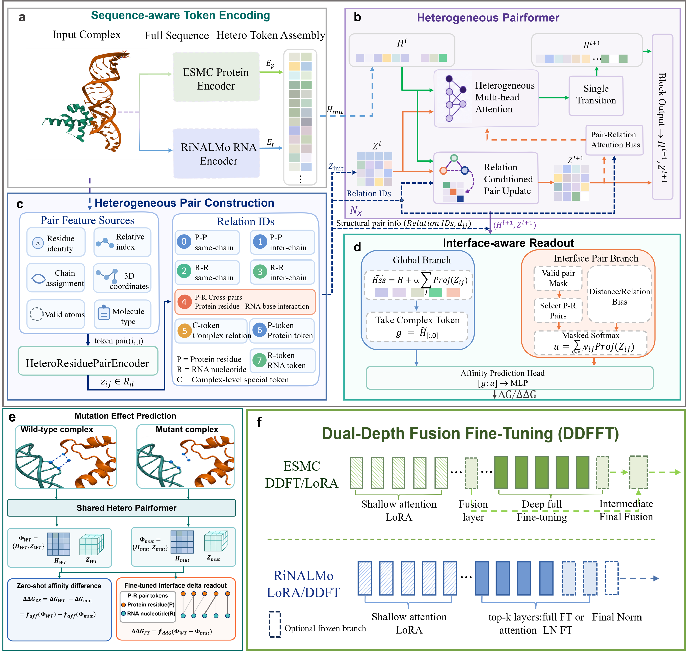

# HARP-RPA

HARP-RPA is a protein-RNA binding affinity prediction framework built around heterogeneous residue-pair modeling. It combines pretrained protein and RNA sequence encoders with explicit protein/RNA/interface pair construction, a relation-aware HeteroPairFormer backbone, and an interface-aware readout for complex-level binding free-energy prediction.



The current main model configuration is:

```yaml
./config/models/harp_rpa.yml
```

It uses:

- ESMC-600M as the protein encoder.
- RiNALMo as the RNA encoder.
- Heterogeneous token assembly with complex, protein, and RNA special tokens.
- Heterogeneous residue-pair construction for P-P, R-R, P-R, and special-token pair relations.
- HeteroPairFormer for joint single-token and pair-representation updates.
- `token_interface` pooling, combining the complex token with an interface-aware P-R pair readout.
- Label standardization during affinity training.
- Dual-depth fine-tuning: shallow LoRA and upper-layer fine-tuning for language-model adaptation.

## Installation

Create the recommended conda environment:

```bash
conda env create -f environment.yml
conda activate harp_rpa
```

## Model Weights

HARP-RPA uses ESMC as the default protein encoder. ESMC weights are not included in this repository. By default, the code loads ESMC from the EvolutionaryScale pretrained registry. For offline use, set a local ESMC checkpoint path before running:

```bash
export ESMC_600M_WEIGHTS=/path/to/esmc_600m_2024_12_v0.pth
```

The released HARP-RPA checkpoints and RiNALMo pretrained weights are hosted on Hugging Face:

```bash
hf auth login   # required if the Hugging Face repository is private
hf download bowen12355/HARP-RPA-V1 \
  --local-dir weights \
  --exclude README.md \
  --exclude .gitattributes
```

After downloading, the `weights/` directory should contain:

```text
weights/
|-- rinalmo_giga_pretrained.pt
|-- HARP-RPA_PRA310_S_5fold/
|   |-- HARP-RPA_fold0.ckpt
|   |-- HARP-RPA_fold1.ckpt
|   |-- HARP-RPA_fold2.ckpt
|   |-- HARP-RPA_fold3.ckpt
|   `-- HARP-RPA_fold4.ckpt
|-- HARP-RPA_PRA310_benchmark_5fold/
|   |-- HARP-RPA_fold0.ckpt
|   |-- HARP-RPA_fold1.ckpt
|   |-- HARP-RPA_fold2.ckpt
|   |-- HARP-RPA_fold3.ckpt
|   `-- HARP-RPA_fold4.ckpt
|-- mCSM_RNA_supervised/
|   |-- fold_0/HARP-RPA_mCSM_fold0.ckpt
|   |-- fold_1/HARP-RPA_mCSM_fold1.ckpt
|   |-- fold_2/HARP-RPA_mCSM_fold2.ckpt
|   |-- fold_3/HARP-RPA_mCSM_fold3.ckpt
|   `-- fold_4/HARP-RPA_mCSM_fold4.ckpt
`-- MS2_5fold/
    |-- HARP-RPA_MS2_fold_0.ckpt
    |-- HARP-RPA_MS2_fold_1.ckpt
    |-- HARP-RPA_MS2_fold_2.ckpt
    |-- HARP-RPA_MS2_fold_3.ckpt
    `-- HARP-RPA_MS2_fold_4.ckpt
```

## Model Type

All HARP-RPA model configs use:

```yaml
model:
  model_type: harp_rpa
```

The model registry is defined in `models/model.py` through:

```python
@R.register("harp_rpa")
```

Use the current HARP-RPA configs listed below.

## Key Configurations

Available model configs:

```text
config/models/harp_rpa.yml
config/models/esmc_hpra_frozen.yml
config/models/esmc_rinalmo_seq.yml
config/models/ablate_ft_ddft.yml
config/models/ablate_ft_ddft_large.yml
config/models/ablate_ft_frozen_lm.yml
config/models/ablate_ft_lora_only.yml
```

Recommended main affinity model:

```bash
--model_config ./config/models/harp_rpa.yml
```

Sequence-only language-model baseline:

```bash
--model_config ./config/models/esmc_rinalmo_seq.yml
```

Fine-tuning ablations:

```text
ablate_ft_frozen_lm.yml    frozen language models
ablate_ft_lora_only.yml    LoRA-only adaptation
ablate_ft_ddft.yml         dual-depth fine-tuning
ablate_ft_ddft_large.yml   stronger top-layer fine-tuning
```

## Datasets

Expected dataset configs:

```text
config/datasets/PRA310.yml
config/datasets/PRA201.yml
config/datasets/mCSM.yml
config/datasets/blindtest.yml
config/datasets/MS2.yml
```

PRA310 and PRA201 are used for supervised binding affinity prediction. The target is binding free energy `dG`. Mutation-effect experiments use mCSM-style `ddG` data when available.

Dataset files and structures should be placed under `./datasets` according to the paths in each dataset YAML file.

## Training

Run HARP-RPA on PRA310:

```bash
python run.py \
  --model_config ./config/models/harp_rpa.yml \
  --data_config ./config/datasets/PRA310.yml \
  --run_config ./config/runs/finetune_struct.yml \
  finetune dG
```

Run HARP-RPA on PRA201:

```bash
python run.py \
  --model_config ./config/models/harp_rpa.yml \
  --data_config ./config/datasets/PRA201.yml \
  --run_config ./config/runs/finetune_struct.yml \
  finetune dG
```

Run a sequence-only baseline:

```bash
python run.py \
  --model_config ./config/models/esmc_rinalmo_seq.yml \
  --data_config ./config/datasets/PRA310.yml \
  --run_config ./config/runs/finetune_struct.yml \
  finetune dG
```

## Testing

Evaluate a trained checkpoint on an affinity dataset:

```bash
python run.py \
  --model_config ./config/models/harp_rpa.yml \
  --data_config ./config/datasets/PRA310.yml \
  --run_config ./config/runs/test_basic.yml \
  test dG
```

### mCSM-RNA mutation-effect prediction

Extract the mCSM-RNA dataset so that the split file is `datasets/mCSM_RNA/splits/blindtest.csv` and the structures are in `datasets/mCSM_RNA/PDBs/`.

#### Zero-shot transfer

Use the five PRA310 Benchmark checkpoints from `weights/HARP-RPA_PRA310_benchmark_5fold/`.

```bash
python run.py \
  --model_config ./config/models/harp_rpa.yml \
  --data_config ./config/datasets/blindtest.yml \
  --run_config ./config/runs/zero_shot_blindtest.yml \
  test ddG
```

#### Supervised mutation-effect prediction

Use the five released mCSM fine-tuned checkpoints under `weights/mCSM_RNA_supervised/`.

```bash
python run.py \
  --model_config ./config/models/harp_rpa.yml \
  --data_config ./config/datasets/blindtest.yml \
  --run_config ./config/runs/test_blindtest_mCSM_harp.yml \
  test ddG
```

### MS2-RNA affinity prediction

Download the [five MS2-RNA checkpoints](https://huggingface.co/bowen12355/HARP-RPA-V1/tree/main/MS2_5fold) to `weights/MS2_5fold/` and run the test command.

```bash
python run.py \
  --model_config ./config/models/harp_rpa_ms2.yml \
  --data_config ./config/datasets/MS2.yml \
  --run_config ./config/runs/test_ms2.yml \
  test dG
```


To retrain all five folds, use the training configuration.

```bash
python run.py \
  --model_config ./config/models/harp_rpa_ms2.yml \
  --data_config ./config/datasets/MS2.yml \
  --run_config ./config/runs/finetune_ms2.yml \
  finetune dG
```


### PRA310 protein sequence-aware split below 50% identity

Use the included `datasets/PRA310/splits/PRA310_sequence_aware_p50.csv` with the structures in `datasets/PRA310/PDBs/`.

Train and evaluate the five folds.

```bash
python run.py \
  --model_config ./config/models/harp_rpa.yml \
  --data_config ./config/datasets/PRA310_sequence_aware_p50.yml \
  --run_config ./config/runs/finetune_struct.yml \
  finetune dG
```
## Main Architecture

HARP-RPA follows this pipeline:

1. Encode protein and RNA sequences with ESMC and RiNALMo.
2. Assemble protein, RNA, and complex-level tokens.
3. Construct heterogeneous residue/base pair features from residue identity, relative index, chain assignment, coordinates, molecule type, valid atoms, and relation IDs.
4. Update token and pair representations with HeteroPairFormer.
5. Predict binding free energy with an interface-aware readout.

The relation IDs used by the heterogeneous pair encoder are:

```text
0: P-P same-chain
1: P-P inter-chain
2: R-R same-chain
3: R-R inter-chain
4: P-R cross-pair
5: complex-token relation
6: protein-token relation
7: RNA-token relation
```

## License

Original HARP-RPA code and modifications by Bowen Wang are
licensed under the [MIT License](LICENSE).

Third-party code retains its original copyright notices and licenses. In
particular, the bundled RiNALMo code remains under its Apache License 2.0
([RiNALMo/LICENSE](RiNALMo/LICENSE)). This project license does not replace
the licenses of third-party code, pretrained models, model weights, or datasets.
