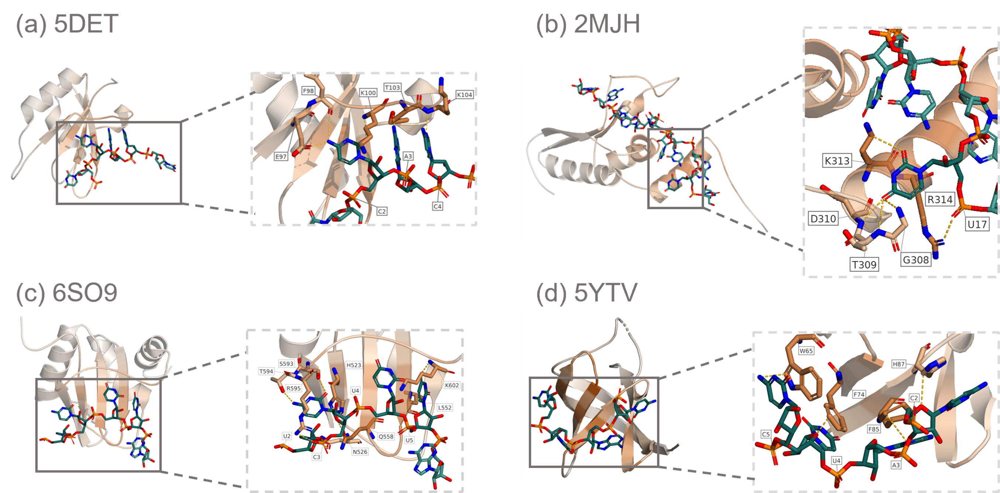

# Structural Interpretation of Interface Readout

  

Controlled structural-padding sensitivity results (Table S8) for the four displayed cases (`5DET`, `2MJH`, `6SO9`, `5YTV`), evaluated at native lengths ($L_0$) and extended padded lengths ($L \in \{192, 256\}$):

<table width="100%">
  <thead>
    <tr>
      <th align="center">PDB</th>
      <th align="center"><i>L</i>0</th>
      <th align="center"><i>L</i></th>
      <th align="center">&Delta;&#770;&Delta;<i>G</i> (kcal/mol)</th>
      <th align="center">Pair &rho;</th>
      <th align="center">Protein &rho;</th>
      <th align="center">Learned protein &rho;</th>
    </tr>
  </thead>
  <tbody>
    <tr>
      <td align="center">5DET</td>
      <td align="center">104</td>
      <td align="center">192</td>
      <td align="center">-0.01024</td>
      <td align="center">0.999849</td>
      <td align="center">0.999841</td>
      <td align="center">0.871835</td>
    </tr>
    <tr>
      <td align="center">5DET</td>
      <td align="center">104</td>
      <td align="center">256</td>
      <td align="center">-0.03507</td>
      <td align="center">0.999659</td>
      <td align="center">0.999725</td>
      <td align="center">0.732009</td>
    </tr>
    <tr>
      <td align="center">2MJH</td>
      <td align="center">152</td>
      <td align="center">192</td>
      <td align="center">+0.31205</td>
      <td align="center">0.999460</td>
      <td align="center">0.999505</td>
      <td align="center">0.941843</td>
    </tr>
    <tr>
      <td align="center">2MJH</td>
      <td align="center">152</td>
      <td align="center">256</td>
      <td align="center">+0.56518</td>
      <td align="center">0.998880</td>
      <td align="center">0.998588</td>
      <td align="center">0.658694</td>
    </tr>
    <tr>
      <td align="center">6SO9</td>
      <td align="center">120</td>
      <td align="center">192</td>
      <td align="center">+0.11689</td>
      <td align="center">0.999891</td>
      <td align="center">0.999778</td>
      <td align="center">0.955231</td>
    </tr>
    <tr>
      <td align="center">6SO9</td>
      <td align="center">120</td>
      <td align="center">256</td>
      <td align="center">+0.09340</td>
      <td align="center">0.999711</td>
      <td align="center">0.999505</td>
      <td align="center">0.947133</td>
    </tr>
    <tr>
      <td align="center">5YTV</td>
      <td align="center">80</td>
      <td align="center">192</td>
      <td align="center">+0.04518</td>
      <td align="center">0.999604</td>
      <td align="center">0.999516</td>
      <td align="center">0.732859</td>
    </tr>
    <tr>
      <td align="center">5YTV</td>
      <td align="center">80</td>
      <td align="center">256</td>
      <td align="center">+0.00901</td>
      <td align="center">0.999548</td>
      <td align="center">0.999260</td>
      <td align="center">0.585718</td>
    </tr>
  </tbody>
</table>
